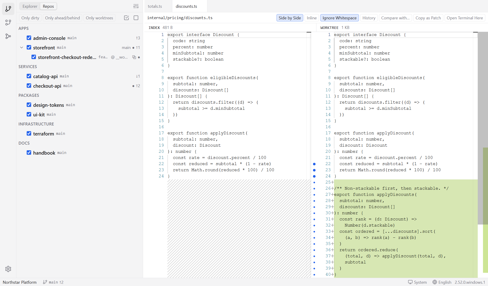

English | [简体中文](README.zh-CN.md)

> 🚧 **WIP / Early Development**
>
> GitTreeDesk is in early development. Features, APIs, configuration, and project structure may change without notice.
> It is not production-ready yet. Feedback and experiments are welcome.

---

<p align="center">
  
</p>

<h1 align="center">GitTreeDesk</h1>

<p align="center">
  <em>A workspace-first multi-repo Git workbench for monorepos and worktrees. Built with Electron.</em>
</p>

<p align="center">
  
</p>

GitTreeDesk lets you open **any folder as a workspace**, discover all Git repositories and worktrees inside it, and manage them from one tree.

## Why GitTreeDesk

VSCode is excellent for single-repo projects, but when you manage 100+ Git repositories under one large folder, it becomes slow and fragmented:

- File watchers struggle with huge directory trees
- Git status refreshes slowly across many repositories
- File browsing and Git operations are split across different views
- Worktree workflows are not first-class

GitTreeDesk takes a different approach: **not a general-purpose IDE, but a workspace-first Git workbench for many repositories.**

## Core Features

- 🌲 **Workspace-first** — Open any folder. The root does not need to be a Git repository.
- 🎯 **Multi-repo tree** — Discover and browse all Git repositories inside the workspace.
- 🌿 **Worktree-aware** — Detect, display, create, and remove Git worktrees.
- 🔀 **Full Git workflow** — Commit, branch, merge, rebase, stash, cherry-pick, fetch, pull, push.
- 📊 **Git Graph** — Visualize commit history across repositories.
- ✏️ **Monaco editor** — Syntax highlighting, TypeScript hints, and diff views.
- 🌍 **English-first i18n** — English by default, with i18n-ready architecture.
- 🌙 **Dark mode** — Follow system theme or switch manually.
- 🚀 **Performance-first** — Lazy loading, incremental updates, and SQLite caching.

## Requirements

- Git **≥ 2.23** (≥ 2.36 recommended), read from `PATH`. A non-standard location can be set in Settings.
- Windows 10+ · macOS 11+ · Linux (AppImage or deb).

## Download

Installers and portable archives are published on the [releases page](https://github.com/GitTreeX/GitTreeDesk/releases): an NSIS `.exe` installer plus a portable `.zip` for Windows, a `.dmg` for macOS, and an `.AppImage` plus a `.deb` for Linux.

macOS builds are unsigned while notarization is deferred, so the first launch needs an explicit **Open** confirmation in Gatekeeper.

## Build from source

Requires Node ≥ 22 and pnpm 12 (the `packageManager` field pins the version).

```bash
pnpm install
pnpm build:native            # compiles node-pty where no prebuild ships (Linux)
pnpm dev                     # development, with hot reload
pnpm build && pnpm package:win   # artifacts land in release/ (package:mac / package:linux also exist)
pnpm smoke:packaged          # boot the packaged build and assert it comes up
```

`pnpm typecheck` and `pnpm test` cover the whole workspace; `pnpm fixture` generates the large multi-repo workspace the performance budgets are measured against.

## Documentation

- [User guide](docs/guide/README.md) — what every screen does, one page per feature
- [Engineering reference](docs/spec.md) — architecture, key decisions, performance budgets
- [Changelog](CHANGELOG.md)

The published site — [English](https://gittreex.github.io/GitTreeDesk/) ·
[简体中文](https://gittreex.github.io/GitTreeDesk/zh-Hans/) — is built from these files by
`website/` (Docusaurus). `pnpm docs:start` previews it locally, `pnpm docs:build` renders the
static bundle, and pushing to `main` deploys it through GitHub Actions.

## License

MIT — see [LICENSE](LICENSE).
